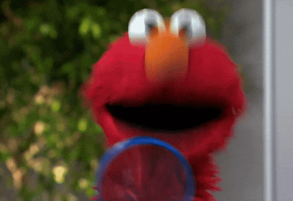
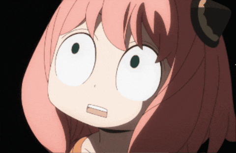
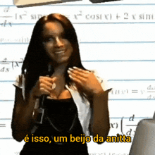

### 🌸 Reflexão: Conclusão sobre posts e disciplina!

Oii meninas!

Chegamos ao ultimo post....talvez? ....
Foi muito divertido fazer esse blog e participar da disciplina, ela é tudo o que eu pensava desde o primeiro post até agora e muito mais!
Eu imaginava descobrir a verdade... 

Mas sinto que não só descobri essa verdade mas me tornei capaz de explorá-la.

## Sobre a disciplina:

Me senti descobrindo os segredos de um mágico!! 
Descobrir que imagens são manipuladas através de fórmulas matemáticas ligou uma chavinha no meu cérebro! E descobrir a relação disso tudo com artes que tanto amo, como mostrado no blog 2, foi incrível e essencial para meu interesse na disciplina.

Como uma girls girl, sempre gostei de editar fotos, ensinar e aprender sobre, mas sempre ficava no básico, aceitava nomes como:
* Exposure
* Hue
* Sharpening
* Blur

Apenas pelo efeito que faziam em cada imagem de forma muito rasa, muitas vezes eu apenas experimentava tacando tudo em uma imagem para ver se ficava bom, sem saber o que cada coisa representava.

Foi incrível não só ver como as coisas funcionam, mas também entender o impacto que um trabalho na tecnologia, mesmo no back do back do back end lidando com 0's e 1's ou trabalhando com o power point e editando fotos para ficar bem diva, reflete diretamente no que vemos. Nunca tinha passado na minha cabeça o fato de uma imagem ser programável e gerável de forma numérica.
O surgimento de IAs generativas me deixavam intrigada, mas nunca tinha pensado em como uma imagem é gerada como uma nova matriz de *números*, *calculada* a partir de *distribuições estatísticas* e *representações matemáticas* aprendidas durante os treinamentos ou prompts.

Mas de longe, minha matéria favorita foram as sobre 3D, tenho uma história longa com isso! aprendi na pandemia e me esforcei para conseguir ter um computador para renderizar e coninuar aprendendo. Via um futuro profissional... e BUM!

A IA veio tirando todas as minhas esperanças, pois a arte que eu fazia em horas, ela conseguia fazer em minutos. Por isso, não me aprofundei muito em nomes, funções, continuei no hobbie, fazendo só o que parecia dar certo. Assim como na edição de imagens, eu só sabia que UV mapping era um negocio chato de fazer a forma caber em um quadrado plano, poligonos pesam e sempre usava os sliders pois não entendia por que tudo tinha números. As aulas me ensinaram tudo o que eu não tive coragem de buscar, pra que serve cada uma dessas abas, até a de rendering que eu estava tão familiarizada. Estou genuinamente motivada a desbravar as abas que eu tinha medo como a de mapping e texturas no blender!

E por último, ãmooooo Minecraft e descobrir o que é um shaders e que *EU posso programar* ele foi incrível! Irei tentar e assim que conseguir e falo pra vocês manas!

## Sobre o blog:

Entender que todos os filtros que já usei em minhas fotos são fórmulas aplicadas de formas diferentes e até fazer essa aplicação (projeto do primeiro bimestre) me despertou uma curiosidade enorme. Portanto me empenhei em buscar relação dos conteúdos aprendidos com meu repertório cultural, pois imagino que essa seja a melhor forma de aprender.

Logo nos primeiros posts pude entender de fato para que tudo aquilo de matriz, intensidade, pixels serve: As artes vetorias por exemplo, são uma graaande descoberta para mim.

Me arrependo muito de não ter me dedicado nesse bimestre com o blog, perdão meninas! 
Pequei em não fazer uns posts... Adoraria ter relacionado tudo o que aprendi sobre o mundo e a representação 3d com minha arte e os jogos que eu jogo... Talvez eu faça isso mesmo! 
Já me segue para ver os próximos posts!!!

Beijinhos e até a próxima! *ੈ✩‧₊˚